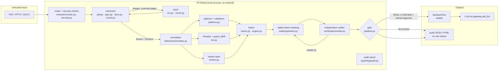
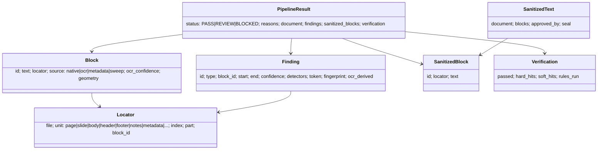

# Architecture

PII Shield is a local, fail-closed gateway between business documents and an LLM. It turns a PDF (native or scanned),
PPTX or DOCX into sanitised text in which every detected personal value is replaced by a stable token, verifies that
output with independent logic, and releases it only through a sealed gate.

## Component view

## Pipeline stages

| Stage | Module | Contract |
|---|---|---|
| Route and validate | `extraction/router.py`, `security.py` | Real type from magic bytes; size, zip-entry count, ratio and total size, path traversal, encryption and XXE checks before any parsing. Any violation raises a typed error. |
| Extract | `extraction/pdf.py`, `pptx.py`, `docx.py`, `ooxml.py` | Produces `Block`s (text + `Locator` = file, unit, page/slide, part, block id). Covers body, tables, text boxes, headers/footers, footnotes, notes, masters/layouts, alt text, hyperlinks, document metadata, and an XML completeness sweep for anything the structured walk missed. |
| OCR | `extraction/ocr.py`, `vector.py` | Scanned pages and embedded images go through Tesseract with per-word boxes and confidence; a second pass reads glyph ink the first pass missed; EMF/WMF are rendered with a local LibreOffice when present. Page OCR confidence and ink coverage are recorded. |
| Normalise | `detection/normalize.py` | Unicode folding (zero-width, full-width, look-alikes), whitespace and line-wrap repair, with an offset map back to the original text. |
| Detect | `patterns.py`, `ner.py`, `names.py` | Deterministic patterns with validators (e-mail, phone, IDs, SSN, tax IDs, passport, DOB, address, financial, IP), Presidio + spaCy NER as an independent recall layer, and a names layer (gazetteers, context patterns, per-document registry of name variants). |
| Fuse | `fusion.py`, `engine.py` | Merges overlapping candidates, resolves type conflicts by priority, combines evidence (noisy-OR), applies thresholds: >= mask threshold is masked, the review band becomes a REVIEW candidate. Cross-block pass for numbers split by OCR layout. |
| Mask | `masking/tokens.py` | Replaces each finding with a stable per-document token (`[PERSON_3]`); the same entity gets the same token everywhere. No reversible vault; the audit fingerprint is a keyed HMAC. |
| Verify | `verification/verifier.py` | Separate, deliberately over-sensitive rule set that imports nothing from `detection`. HARD hits = residual PII almost certain; SOFT hits = a human should look. |
| Heal | `pipeline.py` | HARD hits are mapped back to source text (piecewise around existing tokens) and force-redacted; up to four rounds. SOFT name hits in OCR-derived blocks are force-redacted too (decision of 2026-10-11). |
| Gate | `pipeline.py` | **PASS** only if no HARD hits remain and no review signal exists. **REVIEW** for forced redactions, SOFT hits, low-confidence candidates, weak OCR, unsupported media. **BLOCKED** for any extraction/security error, an unexpected exception, empty extraction, or HARD hits that could not be healed. |
| Release | `pipeline.release`, `gateway.py` | The only way to get LLM-facing text: returns a sealed `SanitizedText`. BLOCKED never releases; REVIEW needs a named approver. `gateway.ask_llm` accepts only a sealed object and verifies the caller's instruction too. |
| Report | `reporting/audit.py` | Audit JSON/HTML: status, reasons, counts by type and classification, locators, offsets, tokens, fingerprints, verifier rules. Never values. |

## Data model (`models.py`)

Traceability: every finding resolves to `file -> page/slide/section -> block id -> char span -> detectors -> confidence`.

## Trust boundaries

1. **Document -> gateway:** the file is hostile until the router and parsers accept it (zip bombs, XXE, traversal,
   decompression bombs, encryption, type confusion).
2. **Gateway -> LLM:** only a sealed `SanitizedText` crosses; anything else is refused in `gateway.ask_llm`.
3. **Gateway -> operator (UI, CLI, audit):** no raw values in logs, reasons, audit files or the findings table; the
   original text is shown only when the operator turns "reveal" on, and sanitised blocks that still carry a verifier HARD
   hit are hidden the same way.

There is no network use while processing (enforced by tests that make socket creation fail).

## Determinism and configuration

`settings.py` holds every threshold and limit; `Settings.digest()` is recorded in each result. Rules are deterministic,
the NER model is pinned by name (`en_core_web_lg`), and the same input with the same settings gives the same findings.
Deployment-specific allow-lists (organisations, corporate addresses, business vocabulary, UI labels) live in
`config/allowlist.json`.

## Evaluation harness (`eval/`)

`python -m pii_shield.eval` runs the pipeline on the samples, scores it against value-based ground truth, and reports
leaks, recall, precision and structure retention; `--render-ocr` runs the OCR-vs-native comparison. Definitions:
`docs/METRICS.md`; results: `docs/RESULTS.md`.
