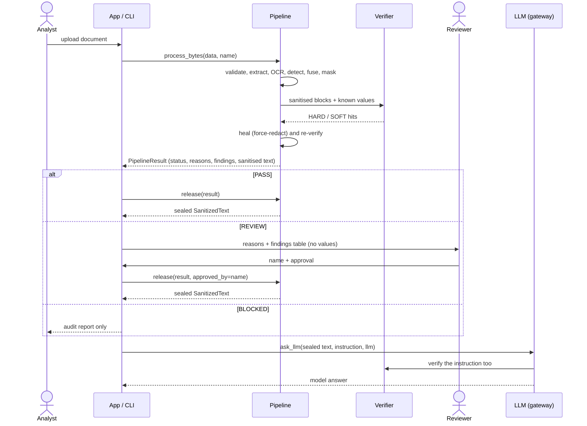
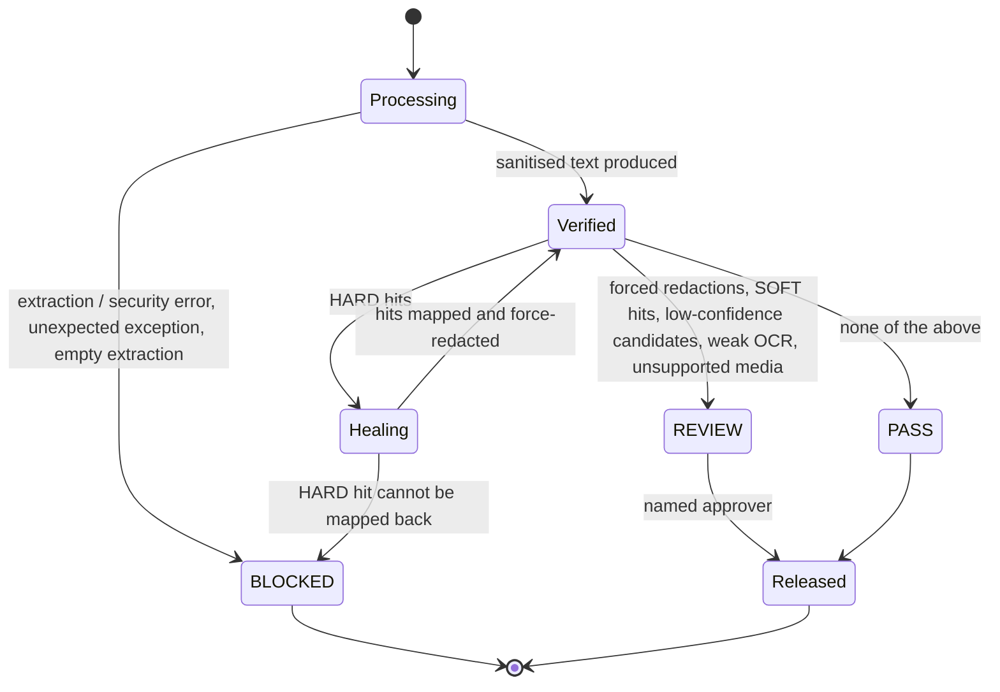

# Functional design

## Users and goals

| User | Goal | Interface |
|---|---|---|
| Analyst | Send a business document to an LLM without exposing personal data | Streamlit app, CLI |
| Reviewer | Decide whether a REVIEW document may be released | Streamlit app (named approval), CLI `--approve` |
| Integrator | Call an LLM only with verified text | `pipeline.release()` + `gateway.ask_llm()` |
| Auditor / privacy officer | See what was found and why a document was held, without seeing the values | Audit JSON / HTML |

## Functions

| # | Function | Behaviour |
|---|---|---|
| F1 | Accept a document | PDF (native or scanned), PPTX, DOCX up to the configured size; anything else, or anything malformed, is BLOCKED with a reason. |
| F2 | Extract text with locations | Every text unit becomes a block with a locator (page/slide, part, block id); images and scanned pages are OCR'd. |
| F3 | Detect and classify PII | Taxonomy below; each finding carries type, span, confidence and the detectors that agreed. |
| F4 | Mask with stable tokens | `[TYPE_n]`, the same entity gets the same token across the document so an LLM keeps the relationships. |
| F5 | Verify independently | A second rule set re-scans the sanitised text; residual hits are force-redacted or hold the document. |
| F6 | Decide | PASS / REVIEW / BLOCKED with machine-readable reasons. |
| F7 | Release | Sealed sanitised text; BLOCKED never, REVIEW only with a named approver. |
| F8 | Report | Audit JSON/HTML with counts, locations, tokens and fingerprints; never raw values. |
| F9 | Measure | Evaluation harness: leaks, recall, precision, structure retention, OCR vs native. |

## End-to-end flow

## Status logic

Status reasons (as they appear in results and the audit): `VERIFIER_HARD_HITS`, `VERIFIER_FORCED_REDACTION`,
`OCR_NAME_REDACTION`, `VERIFIER_SOFT_HITS`, `LOW_CONFIDENCE_CANDIDATES`, `LOW_OCR_CONFIDENCE`, `OCR_COMPLETENESS`,
`UNSUPPORTED_MEDIA`, `EMPTY_EXTRACTION`, plus the typed extraction/security error codes (`CORRUPT_FILE`, `OCR_FAILED`,
`ZIP_BOMB`, ...).

## PII taxonomy

| Type | Examples of form (synthetic) | Primary evidence |
|---|---|---|
| PERSON | full names, initials + surname, hyphenated and non-Western names, names in tables, org charts, screenshots, metadata | names layer + NER + context patterns |
| EMAIL | personal mailboxes, OCR variants with spaces around `@` | regex + Presidio |
| PHONE | international and US formats, numbers wrapped or split by layout | regex + validators + split-number logic |
| EMPLOYEE_ID | `EMP-`, `DIR-`, contingent worker IDs | regex + context |
| SSN | `9xx-xx-xxxx` style | regex + context |
| TAX_ID | Indian PAN, other national tax IDs | regex + context |
| PASSPORT | alphanumeric with a passport context word | context regex |
| DATE_OF_BIRTH | dates next to DOB/birth context only | date regex + context |
| ADDRESS | home street addresses (corporate addresses allow-listed) | address patterns |
| FINANCIAL_ACCOUNT | card numbers (Luhn), IBAN, "ending 1234" fragments | regex + validators + context |
| IP_ADDRESS | IPv4 | regex |

Not PII by decision: company and regulator names, role and distribution mailboxes, corporate addresses, reference
numbers (`INC-`, `ISS-`, `GRP-POL-`, ...). See `docs/DECISIONS.md`.

## Tokens

`[PERSON_1] approved the exception requested by [PERSON_2] ([EMPLOYEE_ID_4], [EMAIL_2])`: tokens are sequential per
document and per type; the same person keeps the same token across spellings recognised as one identity. There is no
de-masking: the mapping is not stored. The audit report links each token to a keyed fingerprint so two runs with the
same key can be correlated without revealing values.

## Interfaces

- **App:** `streamlit run src/pii_shield/app/main.py`: upload or pick a sample; status banner with reasons; findings
  table (no values); original vs sanitised view (original hidden unless "reveal" is on); verification hits; audit
  downloads; release with reviewer name for REVIEW.
- **CLI:** `python -m pii_shield scan FILE... --out out/ [--approve NAME]`: writes `*.audit.json`, `*.audit.html` and,
  if released, `*.sanitized.txt`. Exit code 0 released, 1 held for review, 2 blocked.
- **Python:** `process_path()` / `process_bytes()` -> `release()` -> `gateway.ask_llm(text, instruction, llm)`.
