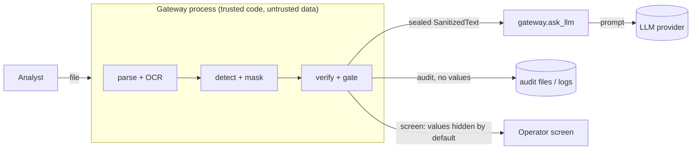

# Threat model

Scope: the PII Shield gateway as a local process (CLI, Python API, Streamlit demo) that receives business documents and
releases sanitised text to an LLM integration. Controls and their tests are listed in `docs/SECURITY.md`.

## Assets

| Asset | Why it matters |
|---|---|
| Personal data inside documents | The thing being protected; leaking it to an LLM provider, logs or a screen is the main harm. |
| Sanitised text and its release decision | If a wrong PASS is issued, PII leaves the trust boundary. |
| Audit reports and logs | Read by more people than the documents; must not become a second copy of the PII. |
| HMAC key (`PII_SHIELD_KEY`) | Lets fingerprints be correlated across runs; with it, guessed values can be confirmed. |
| Gateway host | Parsing hostile files can be used to attack the machine. |

## Actors

- **Honest analyst** who uploads the wrong file or ignores a REVIEW banner (most likely source of harm).
- **Malicious document author** who crafts a file to crash, exhaust or exploit the parser, or to smuggle PII past
  detection (obfuscation, layout tricks, text in images, prompt injection).
- **Downstream LLM provider** that may log, retain or train on what it receives.
- **Local attacker or malicious code in the same process**: out of scope beyond the controls noted.

## Trust boundaries and data flow

## Threats and mitigations (STRIDE-style)

| # | Threat | Category | Mitigation | Evidence |
|---|---|---|---|---|
| T1 | Zip bomb, huge XML, decompression-bomb image | DoS | Entry count, ratio and total-size limits; XML part size limit; image pixel limit; page limit; OCR timeouts | `test_security.py` (zip bomb ratio/total/entries), `ocr.load_image` |
| T2 | XXE / external entity, path traversal in OOXML | Tampering / info disclosure | DTD/ENTITY rejected, lxml with `resolve_entities=False, no_network=True`; traversal entries rejected | `test_xxe_rejected_and_not_resolved`, `test_path_traversal` |
| T3 | Type confusion (PDF renamed DOCX), encrypted or corrupt file | Tampering | Magic-byte typing, extension must agree; encrypted/corrupt -> BLOCKED | `test_pdf_named_as_docx`, `test_encrypted_pdf`, `test_truncated_docx` |
| T4 | PII hidden from the extractor (text boxes, notes, masters, alt text, metadata, tracked deletions, hidden slides) | Information disclosure | Extractors read all of these; XML completeness sweep catches structures the walk missed | extractor code; `test_detection.py` |
| T5 | PII only in images or scanned pages | Information disclosure | OCR of pages and embedded images, second-pass ink recovery, EMF/WMF rendering; unreadable media -> REVIEW (`UNSUPPORTED_MEDIA`), weak OCR -> REVIEW | `test_low_ocr_confidence_forces_review`, `test_incomplete_ocr_forces_review` |
| T6 | Obfuscation (zero-width, full-width digits, look-alike letters, `[at]`) | Information disclosure | Unicode normalisation with offset map; obfuscated e-mail patterns | `test_unicode_and_obfuscation` |
| T7 | Numbers split by layout (wrapped lines, OCR paragraph breaks, interleaved table cells) | Information disclosure | Split-number detection within and across blocks; verifier checks adjacent blocks independently | `test_phone_wrap.py`, `test_split_phone.py` |
| T8 | Detector blind spot | Information disclosure | Independent verifier (shares no code with detection), heal loop, SOFT hits -> REVIEW; OCR-noise name auto-redaction | `test_verifier_does_not_import_detection`, `test_ocr_name_redaction.py` |
| T9 | Release of unverified text | Elevation / info disclosure | Only `release()` builds a sealed `SanitizedText`; BLOCKED never releases; REVIEW needs a named approver; `ask_llm` refuses unsealed or edited input | `test_gateway.py`, `test_blocked_never_releases`, `test_review_needs_named_approver` |
| T10 | PII typed into the LLM instruction | Information disclosure | Instruction is verified with the same independent rules | `test_pii_in_instruction_is_refused` |
| T11 | PII in logs, reasons, audit files | Information disclosure | Logs carry types, counts and codes only; findings carry offsets and HMAC fingerprints, never values | `test_no_pii_in_logs_or_reports`, `test_findings_carry_no_raw_value` |
| T12 | PII on the operator's screen during a demo or screen-share | Information disclosure | Original text hidden unless "reveal" is switched on; sanitised blocks with residual HARD hits hidden too | `test_reveal_is_off_by_default`, `test_blocks_with_residual_pii_are_hidden_unless_revealed` |
| T13 | Network exfiltration from the gateway itself | Information disclosure | No network while processing; tldextract pinned to its bundled list; Streamlit telemetry off | `test_no_network_during_processing`, `test_no_network_with_ner` |
| T14 | Prompt injection inside a document | Tampering of the LLM's behaviour | Not mitigated by design: the gateway removes PII, it does not judge instructions. Downstream prompts must treat document text as data. | `docs/SECURITY.md` (accepted) |
| T15 | Unexpected exception mid-pipeline | Fail-open risk | Every exception -> BLOCKED with the exception type only | `test_unexpected_exception_blocks_without_leaking` |

## Residual risks (accepted or open)

- **Detection is not complete.** The evaluation shows values that leak on the three samples (`docs/RESULTS.md`); such
  documents stay in REVIEW, so the residual control is the human reviewer. A careless approval releases them.
- **OCR can lose text entirely** (unread screenshot regions). An unread value cannot appear in the text output, but a
  visual (image) redaction of a scan would have to cover it; that output does not exist yet.
- **Lone country codes** (`+1`, `+44`) can stay readable; accepted, they identify a country, not a person.
- **Names that look like UI labels** in OCR text are not auto-redacted (decision 2026-10-11); the verifier still raises
  them for review.
- **Same-process attackers** can import the seal key; the seal stops mistakes, not malicious code.
- **Dependency vulnerabilities**: `pip-audit` has not been run yet.
- **Tuning on the reporting set**: the detector was tuned on the same three documents it is measured on.
