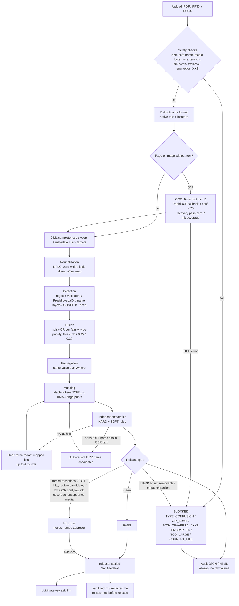
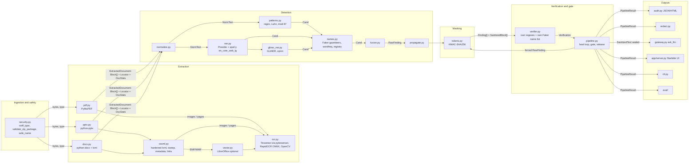

# DECK INPUT: Optiv Case Study 2 (PII Shield / "Cloak")

Status of this file: **THEORETICAL PASS ONLY** (written 2026-10-14 from reading the source at commit `b02df7d`).
No pipeline, eval, test, benchmark or screenshot was run for this version. Every place that needs a measurement says
**PENDING (measure)** and gives the exact command to run. The only measured facts are the Docker container checks in
section 2.3, which were run on 2026-10-14 against the running `cloak` container.

Nothing in this file contains a raw PII value. The worked example in 6.9 uses an invented line that is not taken from
any sample.

---

## 1. PROJECT SNAPSHOT

| Item | Value | Source |
|---|---|---|
| Name | `pii-shield` (UI and Docker image are branded "Cloak") | `pyproject.toml`, `Dockerfile` |
| Version | 1.0.0 | `pyproject.toml` |
| Commit | `b02df7dae0596d02e330ce0c246853349a81c501`, 2026-10-13 19:04:23 +0000 | `git log -1` |
| Python (Docker) | 3.12 (`python:3.12-slim` base) | `Dockerfile` |
| Python / OS (local venv) | PENDING (measure): `.venv/Scripts/python --version`; `python -c "import platform;print(platform.platform())"` | |
| Dev machine OS | Windows 11 Home 10.0.26300 (from the session environment) | |

### git log --oneline (last 25; the repository has 17 commits)
```
b02df7d Cloak: web UI, manual redaction, Docker packaging, docs
7f45931 Better UI
88678b2 Updated Tool; Added gliner + rapidocr
866a3c6 docs: README, architecture, functional design, threat model, file analysis, decisions, limitations, walkthrough; plan checkboxes
6f2cd1b phase-7: demo check on all samples; hide residual-PII blocks unless revealed; replace deprecated width arg; examples as shapes
d5eb02f phase-5: OCR-vs-native eval (--render-ocr via LibreOffice + rasterise); demo display rule for residual PII; scripts
215e29b phase-5: structure retention measured on all three samples; METRICS.md
6e533ea phase-5: structure-retention metric (independent OOXML/page reference) in eval output; tests
d49dd10 phase-5: independent ground truth for DOCX and PDF
de93107 phase-5: eval with Tesseract, before/after results
3a180ae phase-6: auto-redact OCR-noise name candidates; cap eval OCR memory
dc67c25 phase-6: catch phones split by OCR layout in detector, verifier and heal loop
399030d docs: status handoff and plan checkboxes
91cb0db phase-7: app shows audit download for BLOCKED docs; Streamlit smoke tests
18f4fc3 phase-5: eval reports BLOCKED documents instead of crashing
8374a6d phase-8: fix line-wrapped phones in detector and verifier; add test suite (security, fail-closed, privacy, detection, gateway); Streamlit app; sealed SanitizedText + LLM gateway; Windows Tesseract/LibreOffice lookup
d1c9bff phase-0: baseline import of existing pii-shield code and docs
```

### Active settings that change behaviour (`src/pii_shield/settings.py`, defaults)

| Setting | Default | Effect |
|---|---|---|
| `mask_threshold` | 0.45 | fused confidence at or above this => masked |
| `review_band` | 0.30 | 0.30 to <0.45 => not masked, listed as review candidate => document REVIEW; <0.30 dropped |
| `strict_verifier` | **False** | **Strict mode is OFF.** When ON, any SOFT verifier hit turns the document BLOCKED instead of REVIEW |
| `use_ner` / `ner_model` | True / `en_core_web_lg` | spaCy NER through Presidio |
| `use_gliner` | **False** | GLiNER only with `--deep` (CLI) or the UI "deep" option |
| `gliner_model` / `gliner_threshold` | `urchade/gliner_multi_pii-v1` / 0.5 | |
| `use_rapidocr` | True | second OCR engine (PP-OCRv3, ONNX) |
| `rapidocr_always` | False | False = RapidOCR runs only when Tesseract reads nothing or mean word confidence < `rapidocr_below_conf` |
| `rapidocr_below_conf` | 75.0 | |
| `ocr_dpi` | 250 | page render resolution for OCR |
| `ocr_lang` | `eng` | |
| `min_native_chars_for_text_page` | 40 | PDF page with fewer native characters => OCR |
| `low_ocr_confidence` | 60.0 | page mean word confidence below => REVIEW (`LOW_OCR_CONFIDENCE`) |
| `min_ink_coverage` | 0.45 | share of glyph ink inside OCR word boxes below => REVIEW (`OCR_COMPLETENESS`) |
| `ocr_workers` | max(1, min(12, cpu_count - 2)) | Tesseract page parallelism. The eval CLI overrides this to 2 (`--ocr-workers`) |
| Limits | upload 100 MB; 400 PDF pages; 5000 zip entries; 600 MB uncompressed; zip ratio 200 (entries >1 MB); XML part 64 MB; 60 Mpx per image; 400 images; OCR 120 s per call; 1800 s total | `Limits` |
| Config digest | `Settings.digest()` (sha256 of all settings, 16 hex characters) is written into every audit report | |

Allowlist sizes (`src/pii_shield/config/allowlist.json`, entries per key, counted 2026-10-14):
`organisations` 34, `corporate_addresses` 1, `non_pii_id_prefixes` 9, `business_vocabulary` 196, `ui_labels` 89
(plus a `_comment` string).

---

## 2. TECH STACK

### 2.1 Declared dependencies (`pyproject.toml`)

Installed versions: **PENDING (measure)**, `pip list` in the venv and `docker exec cloak pip list`.

| Package | Declared | Used for |
|---|---|---|
| pymupdf | >=1.24 | PDF open/render, text blocks, annotations, links, redaction, rasterising for OCR |
| python-pptx | >=1.0 | slide shapes, tables, charts, notes, layouts |
| python-docx | >=1.1 | DOCX body, sections, headers/footers |
| lxml | >=5 | hardened XML parsing (no entities, no network), XML sweep, structure reference |
| defusedxml | >=0.7 | declared; the code uses an lxml parser with entity resolution off plus an explicit `<!ENTITY` / DTD rejection |
| pytesseract | >=0.3.10 | wrapper for the Tesseract binary |
| rapidocr-onnxruntime | >=1.2,<1.3 | second OCR engine (PP-OCRv3 det/rec + cls ONNX models bundled in the wheel) |
| opencv-python-headless | >=4.9 | grayscale, upscaling, glyph-ink mask, recovery-pass crops |
| pillow, numpy | >=10, >=1.26 | image decoding (pixel-bomb check), arrays |
| presidio-analyzer | >=2.2 | NER wrapper + built-in recognisers (email, phone, US SSN, credit card, IBAN, IP, US passport) |
| spacy | >=3.7 | NLP engine behind Presidio |
| tldextract | >=5 | Presidio dependency; forced onto its bundled suffix list (no network) |
| rapidfuzz | >=3.6 | de-duplicating OCR vs native text and RapidOCR vs Tesseract lines |
| faker | >=24 | first-name / surname gazetteers (locale data only, no generation) |
| wordfreq | >=3.1 | English word frequency (common word vs name) |
| pydantic | >=2.6 | data models |
| starlette, uvicorn, python-multipart | | local web UI / API |
| extras `dev` | pytest, pytest-timeout, ruff, mypy, reportlab, pip-audit, httpx, streamlit | tests, lint, audit |
| extra `deep` | gliner>=0.2 (pulls torch) | GLiNER (opt-in) |
| extra `legacy-ui` | streamlit | old demo `src/pii_shield/app/main.py` |

### 2.2 System tools

| Tool | Role | Version |
|---|---|---|
| Tesseract | main OCR (`--oem 1 --psm 3`, recovery `--psm 7`) | Docker: **5.5.0** (measured). Local: PENDING (`tesseract --version`; STATUS.md mentions 5.5.3) |
| LibreOffice | optional: EMF/WMF to PNG for OCR; `--render-ocr` eval | Docker: **not installed** (measured; build arg `INSTALL_LIBREOFFICE=false`). Local: PENDING |
| poppler | **not used**: PyMuPDF renders pages itself | n/a |
| spaCy model | `en_core_web_lg` 3.8.0 (wheel URL pinned in Dockerfile / setup.sh) | installed in Docker (measured) |

### 2.3 Models actually loaded at runtime

| Model | When | Version / size / licence |
|---|---|---|
| spaCy `en_core_web_lg` | every scan (`use_ner=True`); the parser pipe is disabled | 3.8.0. Size and licence PENDING (the package metadata states the licence; spaCy models are generally MIT) |
| RapidOCR PP-OCRv3 det + rec, ppocr mobile v2 cls (ONNX) | only when Tesseract is missing, reads nothing, or the page mean confidence is <75 | bundled in `rapidocr-onnxruntime` 1.2.x. Size and licence PENDING (PaddleOCR models are Apache-2.0) |
| GLiNER `urchade/gliner_multi_pii-v1` | only with `--deep` | Weights via `scripts/fetch_models.py`. Size and licence PENDING |
| Tesseract LSTM `eng` traineddata | every OCR call | system package |

**Docker image facts (MEASURED 2026-10-14, running container `cloak`, image `8bdb324611ce`, built 2026-10-13 20:06 UTC):**
- `rapidocr_onnxruntime`, `onnxruntime`, `spacy`, `en_core_web_lg` and `presidio_analyzer` are installed. **`gliner` and `torch` are MISSING.** There is no HF cache in the image and `HF_HUB_OFFLINE=1` is set.
- RapidOCR works: called directly on page 1 of the policy PDF, it returned 12 lines in 12.7 s.
- In the pipeline, Tesseract scored a mean confidence of 93.8 on that page, so **RapidOCR is not triggered** (threshold 75).
- Running a scan with `use_gliner=True` in the container gives **BLOCKED `INTERNAL_ERROR: ModuleNotFoundError`** (`torch`). It fails closed, but deep mode does not work there. The UI returns HTTP 400 before trying.
- **Conclusion: the shipped Docker image uses Tesseract + RapidOCR (fallback only) + spaCy/Presidio + rules. It does not use GLiNER.**
- Re-checked 2026-10-14 after a rebuild (image now `62286491d809`): `gliner` and `torch` are **still MISSING** in Docker.

**Local venv GLiNER (MEASURED 2026-10-14):** `gliner` 0.2.29 and `torch` 2.14.1 are installed. The weights for
`urchade/gliner_multi_pii-v1` are in the user HF cache (backbone `microsoft/mdeberta-v3-base` cached too). With
`HF_HUB_OFFLINE=1` the model **loads offline in 53.0 s** (first load, CPU) and predicts on one synthetic line in 1.83 s.
On the 6.9 line it returned EMPLOYEE_ID 0.83, PHONE 1.00, EMAIL 0.97, ADDRESS 0.57, and **no PERSON at threshold 0.5**.
So deep mode works locally but not in Docker.

---

## 3. ARCHITECTURE AND FLOW

### 3.1 Modules (`src/pii_shield/`)

| Module | Purpose | In -> Out |
|---|---|---|
| `security.py` | upload validation before any parser: `safe_name`, magic-byte type sniffing, zip package checks | bytes + name -> type or `SecurityError` |
| `extraction/router.py` | empty/size check, sniff, dispatch | bytes -> `ExtractedDocument` |
| `extraction/pdf.py` | metadata, outline, embedded files, native text blocks, annotations, form fields, links; decides which pages need OCR | PDF bytes -> blocks + stats |
| `extraction/ocr.py` | Tesseract + RapidOCR, recovery pass, ink coverage, OCR cache, parallel drivers | image -> `OcrPage` (paragraphs with word boxes) |
| `extraction/pptx.py` | slides, groups, tables, pictures, charts, alt text, notes, masters/layouts, then images, metadata, links, sweep | PPTX bytes -> blocks |
| `extraction/docx.py` | body in order, nested tables, text boxes, tracked deletions, hidden text, alt text, field codes, headers/footers, foot/endnotes, comments, images (+SVG text), metadata, links, sweep | DOCX bytes -> blocks |
| `extraction/ooxml.py` | hardened XML parse, metadata blocks, external hyperlink targets, **XML completeness sweep**, image OCR helpers | zip parts -> blocks |
| `extraction/vector.py` | EMF/WMF -> PNG through local LibreOffice (optional) | vector image -> PNG or None |
| `detection/normalize.py` | NFKC, drop zero-width characters, Cyrillic/Greek look-alikes -> Latin, odd spaces; exact offset map | text -> `NormText` |
| `detection/patterns.py` | regex + validators per type | text -> `Cand[]` |
| `detection/ner.py` | Presidio/spaCy over context windows (<=4000 chars, same page/slide) | blocks -> `Cand[]` |
| `detection/gliner_ner.py` | optional GLiNER, windows <=1000 chars | chunks -> `Cand[]` |
| `detection/names.py` | layered PERSON logic + document person registry | blocks + NER -> PERSON `Cand[]` |
| `detection/fusion.py` | same-type merge (noisy-OR across detector families), cross-type priority | `Cand[]` -> fused `Cand[]` |
| `detection/engine.py` | orchestrates the above; cross-block split phones; thresholds | `ExtractedDocument` -> `DetectionResult` |
| `detection/propagate.py` | mask every other occurrence of a found value / rare name part | findings -> extra findings |
| `masking/tokens.py` | stable per-document tokens, HMAC fingerprints, sanitised blocks, sanitised->original offset mapping | blocks + findings -> `Finding[]`, `SanitizedBlock[]` |
| `verification/verifier.py` | **independent** residual-PII scan; does not import `detection` | sanitised blocks -> `Verification` |
| `pipeline.py` | extract -> detect -> propagate -> mask -> verify/heal loop (<=4 rounds) -> gate; `release()` | bytes -> `PipelineResult`; result -> `SanitizedText` |
| `classification.py` | confidentiality label (PUBLIC/INTERNAL/CONFIDENTIAL/RESTRICTED) | result -> label + score |
| `reporting/audit.py` | audit JSON/HTML without raw values | result -> report |
| `redact.py` | redacted file in the original format, re-scanned before it is returned | result -> bytes or `BlockedError` |
| `gateway.py` | `ask_llm()` accepts only a sealed `SanitizedText`; also verifies the instruction | sealed text -> injected `llm()` |
| `cli.py` | `pii-shield scan FILE... --out --redact-file --deep --approve` | files -> audit/sanitised/redacted outputs |
| `eval/` | value-based metrics, structure retention, OCR-vs-native rendering | corpus + GT -> metrics JSON |
| `app/server.py` + `static/` | Starlette web UI on 127.0.0.1:8765 (scan, view, approve, manual redact, downloads) | browser <-> pipeline |
| `app/main.py` | legacy Streamlit UI | |

### 3.2 Functional flow (Mermaid)



### 3.3 Component diagram (Mermaid)



### 3.4 Data model (`models.py`)

- **Locator**: `file`, `unit` (page | slide | body | header | footer | footnote | endnote | comment | notes | layout | metadata | hyperlink | outline | sweep), `index` (page/slide number, 1-based, or None), `part` (for example `table r2c3`, `notes`, `shape:Title 1`, `image:word/media/image4.png`), `block_id`.
- **WordBox**: `start`, `end` (character span in the block) -> `x0,y0,x1,y1` pixels on the rendered page/image.
- **Block**: `id`, `text`, `locator`, `source` (native | ocr | metadata | sweep), `ocr_confidence`, `order`, `geometry` (WordBox list, not serialised), `render_dpi`.
- **DocStats**: page_count, block_count, ocr_blocks, ocr_pages, native_chars, ocr_chars, mean_ocr_confidence, low_confidence_pages, ink_coverage{page: fraction}, sweep_blocks, unsupported_media, hidden_content_blocks.
- **ExtractedDocument**: file_name, file_type, sha256, size_bytes, blocks, stats, warnings, source_bytes (not serialised).
- **Finding** (no raw value): id, type, block_id, start, end, confidence, detectors[], locator, token, action, fingerprint (HMAC, 12 hex characters), length, ocr_derived, note.
- **VerificationHit**: severity (HARD|SOFT), rule, block_id, locator, start, end. **Verification**: passed, hard_hits, soft_hits, rules_run.
- **SanitizedBlock**: id, locator, text. **SanitizedText** (frozen): document, blocks, approved_by, seal (per-process HMAC key); `is_sealed()`, `to_text()`.
- **PipelineResult**: status (PASS|REVIEW|BLOCKED), reasons[], document, findings, sanitized_blocks, verification, timings, config_digest, notes (detector stats, confidentiality, forced counts, review candidates).

Traceability chain (rule 5): `Finding.locator.file -> unit/index -> part -> block_id -> start/end -> detectors -> confidence`.

---

## 4. FILE STRUCTURE ANALYSIS (role 01)

**PENDING (measure).** The counts must come from an extraction run, not from older docs. Command to run:
```
python -c "from pii_shield.pipeline import process_path; ..."   # dump doc.stats + Counter(locator.unit, part kind, source) per sample
```
To fill per file: format, size in bytes, page/slide count, block counts by `unit` and `source`, tables, notes, images
(and how many were OCR'd), scanned pages, headers/footers, comments, metadata fields, hidden content blocks, sweep blocks,
unsupported media.

What the code will do with each kind of content, regardless of the counts:

| Content | PDF | PPTX | DOCX |
|---|---|---|---|
| Native text | PyMuPDF `get_text("blocks", sort=True)` per page | text frames per paragraph, groups recursed | body paragraphs in document order |
| Tables | inside page text blocks (no cell structure) | per cell paragraph, `table:<shape> rRcC` | per cell, nested, `table rRcC` |
| Notes | n/a | `notes` per slide | n/a |
| Images | large images on a text page => hybrid OCR, keeping only text not already in the text layer | picture shapes => OCR | inline/VML images => OCR, inserted after the paragraph; SVG `<text>` read directly |
| Scanned pages | <40 native characters => whole page OCR at 250 dpi | n/a | n/a |
| Headers/footers | part of the page text | masters/layouts as `layout` blocks | per section, de-duplicated, `header`/`footer` |
| Comments / annotations | annotation content + author, form fields, links | n/a (sweep covers the XML) | `comment` text + author/initials |
| Metadata | PDF metadata dict | docProps core/app/custom | docProps core/app/custom |
| Hidden text | n/a | hidden slides counted (still extracted) | tracked deletions extracted; `w:vanish` counted (text is still in the paragraph) |
| Anything else | outline (TOC) entries | XML sweep of `ppt/*.xml` | XML sweep of `word/*.xml` |

Known from the source comment in `pdf.py`: "the Cadence policy is 100% scanned", so the PDF goes entirely through OCR.
The page count is PENDING.

---

## 5. EXTRACTION LOGIC (as the code does it, in order)

### 5.0 Common entry (`router.extract`)
1. Empty => `EMPTY_DOCUMENT`. Over 100 MB => `TOO_LARGE`.
2. `safe_name`: basename only, control characters stripped, 200 characters max (display only; never used to open files).
3. `sniff_type`: the extension must be .pdf/.pptx/.docx and the magic bytes must agree (`%PDF-` or `PK`), otherwise `TYPE_CONFUSION`.

### 5.1 PDF native
1. Open with PyMuPDF. Failure => `CORRUPT_FILE`. Password or encryption => `ENCRYPTED`. 0 pages => `EMPTY_DOCUMENT`. More than 400 pages => `TOO_LARGE`.
2. Metadata fields -> `metadata` blocks. Outline/TOC titles -> `outline` blocks. Embedded files are counted as unsupported media (=> REVIEW).
3. For each page: text blocks (sorted) -> `page N` blocks; annotation content + author, form-field values, and mailto/tel/http links -> blocks.
4. A page with fewer than 40 non-whitespace characters goes to OCR. A text page with an image covering at least 5% of the page (both sides >40 pt) becomes **hybrid**: it is OCR'd too.

### 5.2 PDF scanned / OCR (`ocr.py`)
1. Pages are rendered at **250 dpi** in the main thread. Up to `ocr_workers` pages are OCR'd in parallel (bounded queue: one rendered page per worker plus one queued).
2. Per image: grayscale. If the mean is <90 (dark background) it is inverted. If narrower than 1500 px it is upscaled toward 1800 px (x3 max).
3. **Tesseract** `--oem 1 --psm 3 -c preserve_interword_spaces=1`, timeout 120 s. Words are grouped into paragraphs (block/par/line), keeping word boxes and confidences. Timeout or engine error => `OcrError` => **BLOCKED**. Tesseract missing => RapidOCR only (if enabled).
4. **RapidOCR** runs if there are no paragraphs or the mean confidence is <75, or always if `rapidocr_always`. One RapidOCR instance per thread, 2 ONNX threads each. A RapidOCR line is added only if Tesseract's boxes do not already cover it with similar text (coverage >=0.5 and fuzzy match >=85), so a misread is kept next to the other reading and both are scanned.
5. **Recovery pass**: a glyph-ink mask (black-hat/top-hat morphology, connected components 4-90 px high, <=160 px wide) minus the existing word boxes. Remaining regions (up to 80) are cropped, polarity-fixed, upscaled to about 70 px high and read with `--psm 7`. Words with confidence >=60 are kept. This targets white-on-navy headers, coloured chips and stamps.
6. **Ink coverage** = share of glyph ink inside word boxes (5 px padding). Below 0.45 => `OCR_COMPLETENESS` => REVIEW. Page mean confidence below 60 => `LOW_OCR_CONFIDENCE` => REVIEW.
7. Hybrid pages: an OCR paragraph is dropped if it fuzzy-matches the page's native text (partial ratio >=92).
8. An OCR cache (sha256 of pixels + OCR settings, 256 entries) makes the re-scan of a redacted file cheap.

### 5.3 PPTX
1. `validate_zip_package` (5.5), then python-pptx. No slides => `EMPTY_DOCUMENT`.
2. Per slide (hidden slides counted): every shape, groups recursed. Text frame paragraphs (`shape:<name> pN`), table cells (`table:<name> rRcC`, spanned cells skipped), pictures (queued for OCR), chart title, categories and series names, alt text (`descr`/`title`).
3. Notes (`notes`, slide-number placeholders skipped).
4. Masters and layouts -> `layout` blocks (de-duplicated text).
5. OCR all images in parallel. EMF/WMF go through LibreOffice if present, otherwise they are **unsupported media => REVIEW**. Any OCR failure => **BLOCKED**.
6. Metadata (docProps core/app/custom, noise fields skipped), external hyperlink targets.
7. **XML completeness sweep** over every `ppt/*.xml` (except theme, styles, presentation and similar): paragraphs (including deleted text), chart `c:v`, `descr/title/author/initials` attributes, `a:t` outside paragraphs. Anything whose normalised text is not already in the corpus becomes a `sweep` block and is scanned too. A warning is added.

### 5.4 DOCX
1. `validate_zip_package`, then python-docx.
2. Body in document order: paragraphs, tables (nested, `table rRcC`), `sdt` content controls, `ins/moveTo/customXml/smartTag` wrappers. Per paragraph: tracked deletions (`tracked-deletion`), `w:vanish` counted, drawing alt text, field codes containing `@` or HYPERLINK, text boxes (AlternateContent fallbacks skipped), images queued.
3. Headers/footers for every section and kind (default, first, even), skipped when linked to the previous section and de-duplicated by part.
4. Footnotes, endnotes, comments (comment author and initials too).
5. Image OCR, inserted after the owning paragraph. SVG `<text>` is read directly. Other formats are unsupported => REVIEW.
6. Metadata, external link targets, XML sweep of `word/*.xml`.

### 5.5 Security checks (before and during parsing)

| Threat | Check | Code |
|---|---|---|
| Type confusion | extension vs magic bytes; OOXML must have `[Content_Types].xml` and `word/document.xml` / `ppt/presentation.xml` | `TYPE_CONFUSION` |
| Zip bomb | more than 5000 entries; total uncompressed >600 MB; per-entry ratio >200 on entries >1 MB; XML part >64 MB; read-size mismatch | `ZIP_BOMB` |
| Path traversal | absolute names, `..` segments, backslashes | `PATH_TRAVERSAL` |
| Encryption | zip encrypted flag; encrypted PDF; legacy encrypted OOXML (OLE) fails the magic check | `ENCRYPTED` / `TYPE_CONFUSION` |
| XXE | lxml with `resolve_entities=False, no_network=True, load_dtd=False`, plus explicit rejection of `<!ENTITY` and `<!DOCTYPE ... SYSTEM` | `XXE` |
| Image bomb | more than 60 Mpx per image; more than 400 images | `IMAGE_BOMB` / `TOO_LARGE` |
| Network | tldextract forced offline; `HF_HUB_OFFLINE=1` for GLiNER | |

Tests that exist for these: `tests/test_security.py`, `test_fail_closed.py`, `test_privacy.py`. Results PENDING.

---

## 6. DETECTION AND CLASSIFICATION LOGIC

### 6.1 Types (`models.EntityType`) and audit classification (`models.CLASSIFICATION`)

| Type | Audit class | Label |
|---|---|---|
| PERSON | Direct identifier | Full name |
| EMAIL | Contact detail | Email address |
| PHONE | Contact detail | Telephone number |
| ADDRESS | Contact detail | Residential / postal address |
| EMPLOYEE_ID | Employee identifier | Staff / director number |
| SSN | Government-issued ID | SSN (full or last digits) |
| PASSPORT | Government-issued ID | Passport number |
| TAX_ID | Government-issued ID | National tax identifier (PAN-style) |
| DATE_OF_BIRTH | Sensitive attribute | Date of birth |
| FINANCIAL_ACCOUNT | Financial identifier | Card / account number or fragment |
| IP_ADDRESS | Technical identifier | IP address |
| UNCLASSIFIED | (Unclassified) | produced only by verifier-forced redaction of a long digit run or an unknown value |

That is 11 typed classes, plus UNCLASSIFIED for forced redactions.

**UPDATE 2026-10-14 (uncommitted working tree):** the extended rule set adds 3 types, **GOV_ID** (Aadhaar with Verhoeff,
UK NINO, Canadian SIN with Luhn), **TECH_ID** (MAC, VIN, vehicle plate) and **SECRET** (AWS/GitHub/Google/Slack/Stripe
keys, JWT, private-key blocks, credentials in URLs, password assignments), for **14 typed classes**. It also adds GSTIN
(TAX_ID); IPv6; UK/India mobile phones; SWIFT/IFSC/ABA/BTC/ETH (FINANCIAL_ACCOUNT); UK postcode, US state+ZIP and India
PIN (ADDRESS); and "word" e-mail obfuscation. Shape-only rules are gated (confidence 0.40 => REVIEW, not masked) unless
there is context. The verifier gained independent HARD rules: secret, nino-shape, gstin-shape, mac, ipv6, crypto-address.
Tests: `tests/test_patterns_extra.py`. **The effect on the sample eval is NOT MEASURED yet.**
Later the same day: **GENERIC_ID** catch-all (`PREFIX[-_/]...[-_/]digits`, conf 0.6, lowest fusion priority, allowlist
`non_pii_id_prefixes` and standards prefixes skipped), for **15 typed classes**. The IPv4/IPv6 rules were also fixed:
OCR-damaged, zero-padded, compressed IPv6, short-number context gate, and a verifier `residual-ipv4` rule.

### 6.2 Detectors and confidences (`patterns.py`, `ner.py`, `names.py`, `gliner_ner.py`)

| Type | Detector (name in `detectors`) | Conf. |
|---|---|---|
| EMAIL | `regex:email` / `regex:email-obfuscated` ([at]/[dot]) / `regex:email-ocr-space` | 0.99 / 0.90 / 0.85 |
| PHONE | `regex:phone-intl` (+cc, 8-15 digits, NANP trim, trailing-year trim) | 0.97 |
| | `regex:phone-us` ((NNN) NNN-NNNN, NNN-NNN-NNNN) | 0.90 |
| | `regex:phone-context` (tel/phone/mobile/fax/call + 7-15 digits) | 0.88 |
| | `regex:phone-split` (prefix and continuation split by a line, cell or OCR paragraph; shared identity key) | 0.93 |
| EMPLOYEE_ID | `regex:employee-id` (EMP/DIR/EID-NNNN with OCR-confusable digits O,I,l,S,B) | 0.97 (>=4 digits) / 0.85 |
| | `regex:employee-id-context` (employee/staff/badge ... id/no) | 0.88 |
| | `regex:worker-id` (`AAA-AA-NNNN`) | 0.60 |
| SSN | `regex:ssn` (NNN-NN-NNNN) / `regex:ssn-spaced` (0.90 with SSN context, else 0.50) / `ssn-context-9` / `ssn-last4` / `ssn-masked-last4` | 0.95 / 0.90 or 0.50 / 0.90 / 0.90 / 0.85 |
| TAX_ID | `regex:pan-shape` (AAAAA9999A) / `regex:pan-context` | 0.90 / 0.92 |
| PASSPORT | `regex:passport-context` / `regex:passport-shape` (AA9999999 with no context) | 0.92 / 0.40 (below review band alone) |
| DATE_OF_BIRTH | `regex:dob-context` (a date with DOB/born/date of birth within 40 characters before or 25 after) | 0.93 |
| ADDRESS | `regex:street-address` (number + 1-4 capitalised words + street type, optional unit/city/state/ZIP or UK postcode) | 0.90 if locality/unit/ZIP or home/address context, else 0.70 |
| | `regex:po-box` | 0.80 |
| FINANCIAL_ACCOUNT | `regex:card-luhn` (13-19 digits, Luhn) / `regex:iban-mod97` / `card-fragment` / `account-fragment` / `account-number` | 0.96 / 0.97 / 0.90 / 0.90 / 0.90 |
| IP_ADDRESS | `regex:ipv4` (not 0.x, 127.x, broadcast) | 0.60 |
| Presidio (non-person) | `presidio:<Recognizer>` for email, phone, US SSN, credit card, IBAN, IP, US passport | min(0.9, 0.45 + 0.5 x score) |
| PERSON | `pattern:name-before-id` (Name followed by EMP-/DIR-/EID- or AAA-AA-NNNN) | 0.96 |
| | `pattern:honorific` (Mr/Ms/Dr/Prof...) | 0.90 |
| | `pattern:label` (Name:/Owner:/Approver:...) | 0.90 |
| | `pattern:name-before-title` (Name, CFO / Director / ...) | 0.88 |
| | `pattern:cue-word` (approved by, owner, contact, dear, regards, assigned to, ...) | 0.78 |
| | `presidio:SpacyRecognizer` after filtering (business vocab, orgs, ALL-CAPS, lowercase tokens, single tokens unless a known surname) | 0.62, or 0.80 if the first name is in the gazetteer |
| | email-derived surname (registry only, no direct candidate) | |
| | `heuristic:name-line` (short line that is a name: 0.25 + 0.30 first-name gazetteer + 0.25 NER agreement + 0.35 known surname + 0.15 surname gazetteer, +0.25 if a neighbouring line is a person) | <=0.95 |
| | `lexicon:variant` (other spellings of established persons) | 0.92 / 0.90 / 0.85 / 0.80 / 0.70 / 0.60 / 0.55 |
| GLiNER (if `--deep`) | `gliner:<label>` for 12 labels | PERSON 0.50 + 0.45s; ADDRESS 0.45 + 0.45s; others 0.40 + 0.45s; cap 0.95. A PERSON at >=0.85 is accepted without the name rules |
| any | `propagate` (same value elsewhere; rare name parts >=5 characters, zipf <3.5) | 0.70 |
| any | `verifier:forced` (HARD hit healed) / OCR name candidate | 0.90 / 0.60 |

### 6.3 Fusion (`fusion.py`)
1. Same type, overlapping spans => one candidate covering the union span. Confidence is a **noisy-OR across detector families** (`regex`, `presidio`, `pattern`, `lexicon`, `heuristic`, `gliner`): each family contributes its best score, so `1 - prod(1 - p_family)`, capped at 0.99. Two regexes do not add up; a regex plus spaCy do.
2. Different types on the same characters: the higher **priority** wins: EMAIL 10 > SSN = TAX_ID = PASSPORT = FINANCIAL_ACCOUNT = EMPLOYEE_ID 9 > DOB = PHONE 8 > ADDRESS 7 > IP 5 > PERSON 3. A same-priority candidate replaces the kept one only if it is both more confident and longer.
3. Post-trim of punctuation. A PHONE that looks like `2026-041 13.1` (section/reference number) is dropped. Allowlisted organisation names and corporate addresses are dropped.
4. Thresholds: conf >=0.45 is masked; 0.30 to <0.45 is a review candidate (document => REVIEW); <0.30 is discarded.

### 6.4 Name handling (`names.py`)
- Name shape: 2-5 capitalised tokens, initials, particles (van/de/al...), hyphenated or apostrophe names, accented Latin letters.
- Gazetteers: first names and surnames from every Faker locale (Latin-script only), minus an ambiguous-word list (Park, Bell, Hall, Grace, May...). The verifier uses its **own** first-name set built separately.
- Common-word test: `wordfreq` zipf >=3.0, or a derivational suffix (-tion, -ment, -ity...) => not a name token. `trim_span` strips swallowed leading/trailing everyday words ("Annual X Y" -> "X Y").
- Person registry: `last|first-initial` identity. Every spelling of one person shares one token (`[PERSON_3]` for "R. Duarte", "Rafael Duarte" and "Duarte").
- Cue words: approved/reviewed/prepared/signed/... by, owner, author, reviewer, approver, signatory, sponsor, attn, contact(s), queries, per, c/o, cc, dear, hi, hello, thanks, regards, sincerely, administrator, handler, manager, challenger, incident manager, case handler, led/reported/submitted by, escalated/assigned to. **"Customer", "client", "employee" and "patient" are not cue words** (see 8).

### 6.5 Allowlists (`config/allowlist.json`)
Entry counts are in section 1. They are used for: organisation names (never PERSON; their tokens are also excluded from the verifier name check), one corporate address (not personal data), safe ID prefixes, business vocabulary (kills name false positives like "Risk Owner"), and UI labels (skipped by OCR name auto-redaction). The organisations list and the single corporate address are **deployment-specific** and were tuned on the Cadence samples. Category counts only; contents deliberately not listed here.

### 6.6 Masking (`masking/tokens.py`)
- Tokens `[TYPE_n]`, numbered in document order, **stable inside one document**: the same entity key gives the same token. Keys: PERSON = registry id; EMAIL = lower-cased without spaces; PHONE/SSN/FINANCIAL = digits only; others = alphanumerics upper-cased.
- **No vault**: there is no reverse mapping anywhere. The audit carries `fingerprint = HMAC-SHA256(key, "TYPE|entity_key")[:12]`. The key is `PII_SHIELD_KEY` if set (stable across runs), else 32 random bytes per process.
- Overlaps in original offsets are resolved by keeping the most confident. Replacement goes right to left, so only finding spans change and the surrounding text is untouched.

### 6.7 Independent verifier (`verification/verifier.py`)
Design rule: it must not import `pii_shield.detection`. It blanks our tokens first (same length), then scans:

| Severity | Rule name | What |
|---|---|---|
| HARD | `residual-email` | email shape, including a space around @ |
| HARD | `residual-ssn-shape` | NNN-NN-NNNN |
| HARD | `residual-phone-intl` | +cc with >=8 digits allowing a single line break; also `+cc group` with >=4 digits; also across adjacent blocks of the same page |
| HARD | `residual-phone-local` | (NNN) NNN-NNNN, NNN.NNN.NNNN |
| HARD | `residual-employee-id` | EMP/DIR-NNN with OCR-confusable characters |
| HARD | `residual-pan-shape` | AAAAA9999A |
| HARD | `residual-passport` | "passport" + up to 2 letters + >=5 digits |
| HARD | `residual-dob-context` | DOB/born/date of birth followed by a date-like value |
| HARD | `residual-long-digit-run` | >=9 digits (separators allowed), not ISO dates or year-references; not in metadata/hyperlink blocks |
| HARD | `residual-street-address` | number + capitalised words + street type (corporate allowlist excepted) |
| HARD | `residual-known-value` | any value already masked elsewhere (>=4 characters; PERSON >=5) still readable |
| SOFT | `unclassified-identifier-shape` | `AA(AA)-NNNN(NN)` with an unknown prefix |
| SOFT | `possible-unmasked-name` | capitalised bigram whose first word is in the verifier's first-name list; or First M. Last |
| SOFT | `name-fragment-next-to-token` | capitalised word next to `[PERSON_n]` (**see 8: probably never fires**) |

### 6.8 Heal loop and release gate (`pipeline.py`)
Heal loop, up to 4 rounds:
1. If there are HARD hits, each hit is mapped back to the original text (cut around existing tokens) and force-redacted as `verifier:forced`, typed from the rule (long digit run => UNCLASSIFIED). If nothing can be mapped back, the loop stops and the hit stays.
2. If there are no HARD hits, SOFT name hits **in OCR blocks only** are auto-redacted as PERSON, unless they contain a UI label, business word or organisation token. Native text is never auto-redacted.
3. Re-mask and re-verify.

| Outcome | Condition (first match) |
|---|---|
| **BLOCKED** | any `PiiShieldError` in extraction/OCR (security, corrupt, encrypted, OCR failure/timeout, empty, too large) |
| **BLOCKED** | any unexpected exception (`INTERNAL_ERROR: <type>`) |
| **BLOCKED** | verifier HARD hits remaining after healing (`VERIFIER_HARD_HITS`) |
| **BLOCKED** | no text extracted at all (`EMPTY_EXTRACTION`) |
| **BLOCKED** | SOFT hits **and** `strict_verifier=True` |
| **REVIEW** | verifier forced redactions > 0 (`VERIFIER_FORCED_REDACTION`) |
| **REVIEW** | OCR name candidates auto-redacted (`OCR_NAME_REDACTION`) |
| **REVIEW** | SOFT hits remain (`VERIFIER_SOFT_HITS`) |
| **REVIEW** | candidates in the 0.30-0.45 band (`LOW_CONFIDENCE_CANDIDATES`) |
| **REVIEW** | any OCR page mean confidence <60 (`LOW_OCR_CONFIDENCE`) |
| **REVIEW** | any page ink coverage <0.45 (`OCR_COMPLETENESS`) |
| **REVIEW** | unsupported media: EMF/WMF without LibreOffice, PDF attachments, unknown image formats (`UNSUPPORTED_MEDIA`) |
| **PASS** | none of the above |

Release: `release()` returns a sealed `SanitizedText` for PASS. For REVIEW it needs `approved_by` (a named human). For BLOCKED it never releases. The redacted file follows the same rule and is re-scanned (up to 3 rounds) before it is returned.

### 6.9 Worked example (HAND-TRACED from the code, NOT executed; invented synthetic line, not from any sample)

Raw (synthetic): `Approved by Priya Raman (EMP-20417), tel +44 20 7946 0958, priya.raman@example.com`

| Span | Type | Detectors (expected) | Fused conf (expected) |
|---|---|---|---|
| chars 12-23 | PERSON | `pattern:name-before-id` 0.96 + `pattern:cue-word` 0.78 (same family => 0.96); `presidio:SpacyRecognizer` 0.80 if spaCy tags it | 0.96 to 0.99 |
| chars 25-34 | EMPLOYEE_ID | `regex:employee-id` (5 digits) | 0.97 |
| chars 41-57 | PHONE | `regex:phone-intl` 0.97 + `regex:phone-context` 0.88 (same family); Presidio phone if it fires | 0.97 to 0.99 |
| chars 59-82 | EMAIL | `regex:email` 0.99 (+ Presidio) | 0.99 |

Masked: `Approved by [PERSON_1] ([EMPLOYEE_ID_1]), tel [PHONE_1], [EMAIL_1]`
Verifier: after token blanking no HARD or SOFT rule matches => 0 hits => on its own this line would be **PASS**.

**EXECUTED 2026-10-14 (local venv, `Settings(use_gliner=True)`, one-block document through `Pipeline._process`)**, on
the same line with an invented address appended (`, 42 Willow Lane, Springfield, IL 62704`):

| Span | Type | Conf | Detectors | Token |
|---|---|---|---|---|
| 12-23 | PERSON | 0.99 | lexicon:variant, pattern:cue-word, pattern:name-before-id, presidio:SpacyRecognizer | [PERSON_1] |
| 25-34 | EMPLOYEE_ID | 0.99 | gliner:employee-id, regex:employee-id | [EMPLOYEE_ID_1] |
| 41-57 | PHONE | 0.99 | gliner:phone-number, presidio:PhoneRecognizer, regex:phone-context, regex:phone-intl | [PHONE_1] |
| 59-82 | EMAIL | 0.99 | gliner:email-address, presidio:EmailRecognizer, regex:email | [EMAIL_1] |
| 84-121 | ADDRESS | 0.97 | gliner:street-address, regex:street-address | [ADDRESS_1] |

Sanitised: `Approved by [PERSON_1] ([EMPLOYEE_ID_1]), tel [PHONE_1], [EMAIL_1], [ADDRESS_1]`. Status **PASS**, no
reasons. This matches the hand trace. The PERSON came from the rules and spaCy, not from GLiNER. Without GLiNER, the
fused scores would differ only where GLiNER was the extra family. Not re-run without `--deep`.

---

## 7. MEASURED RESULTS: ALL PENDING

Nothing below was run for this version. Old numbers in `docs/RESULTS.md` must **not** be copied into the deck. Commands to run (record the date/time of each):

| # | What | Command |
|---|---|---|
| 7a | eval on samples | `python -m pii_shield.eval --corpus data/samples --truth data/ground_truth --out docs/deck_pack/eval_samples.json` (STATUS.md advises one file at a time with `--only pptx|docx|pdf` because of memory) |
| 7a' | same in Docker | `docker exec cloak python -m pii_shield.eval --corpus /app/data/samples --truth /app/data/ground_truth --only <x>` |
| 7b | synthetic test set | **`testset/` does not exist in the repo** (checked 2026-10-14: `ls testset` -> not found). NOT MEASURED until a set is provided or built |
| 7c | structure retention | printed by 7a (`structure` key). Definition: see below |
| 7d | OCR vs native | `python -m pii_shield.eval --render-ocr --only pptx` / `--only docx`. **Needs LibreOffice: not possible in the current Docker image** |
| 7e | performance | `timings` in each audit + wall clock + peak RSS per file (`/usr/bin/time -v` in Docker, or psutil locally); CPU model and thread count; batch: `pii-shield scan <dir>/* --out out/` |
| 7f | tests / lint | `pytest -q`; `ruff check .`; `mypy src` |
| 7g | GLiNER ablation | same as 7a with `--deep` (needs a deep image or a local venv with `gliner` + weights) |
| 7h | RapidOCR ablation | same as 7a with `--no-rapidocr` |

Metric definitions (from `eval/metrics.py`, `eval/structure.py`, `docs/METRICS.md`):
- **Occurrence**: a ground-truth value found in a block (whitespace/case-insensitive, word-bounded).
- **Recall**: share of occurrences covered >=50% by a finding, with a Wilson 95% interval. **Typed recall** also requires the right type.
- **Precision**: findings that overlap a ground-truth occurrence (or share a ground-truth fingerprint) divided by all findings.
- **Leaked values** (headline number): ground-truth values still readable in the sanitised text after deleting tokens.
- **not_extracted**: ground-truth values never present in the extracted text.
- **Structure retention**: units (DOCX paragraphs/cells/text boxes/headers/footers/notes; PPTX shape and table paragraphs + notes; PDF = inked pages) that are found AND locator-correct AND in reading order, divided by all units. The reference is built independently of the extractors. Target >=0.80.
- **Context preservation**: by construction only finding spans are replaced (`apply_masking`), so no separate metric exists in the code. If the deck needs a number, it has to be computed (PENDING).

Caveat to state on any slide: the PPTX ground truth was annotated independently. DOCX/PDF ground truth was rebuilt independently on 2026-10-11 (`data/ground_truth/ANNOTATION.md`). **The detectors were tuned on these same three documents**, so the results are in-sample, not a held-out benchmark.

---

## 8. KNOWN PROBLEMS AND LIMITATIONS (from code reading; severity is my estimate; every item still needs a test)

| # | Problem | Evidence (code) | Severity | To confirm |
|---|---|---|---|---|
| 1 | **GLiNER is not in the Docker image.** "Deep" mode BLOCKs with `INTERNAL_ERROR` in the container, and the UI refuses it | measured 2.3; `Dockerfile` installs base deps only | High for claims (the deck must not say Docker uses GLiNER); low for safety (fails closed) | done |
| 2 | **Policy references like `POL-RM-0042` are masked as EMPLOYEE_ID**: `_WORKER = [A-Z]{3}-[A-Z]{2}-\d{4}` matches them at 0.60 (>=0.45) | `patterns.py` `detect_employee_id` | Medium: precision loss, broken references for the LLM | run one line |
| 3 | **A capitalised phrase before such an ID can become PERSON at 0.96**: `P_ID` treats `AAA-AA-NNNN` as an ID cue and skips `accept_tokens`; only the business-vocab/org filter protects it | `names.py` `P_ID` + `detect_people` | Medium (false-positive names) | craft line |
| 4 | **`name-fragment-next-to-token` SOFT rule appears unreachable**: tokens are blanked to spaces by `_strip_tokens` before `_NEAR_TOKEN_A/B` (which look for `[PERSON_n]`) run | `verifier.py` lines in the `verify()` loop | Medium: a missing safety net for half-masked names | unit test |
| 5 | **Names after cue words like "Customer", "Client", "Employee", "Patient"** are not covered by `_CUES`; they depend on spaCy, the gazetteers or line heuristics | `names.py` `_CUES` | Medium-High for customer-facing documents | craft 5 lines |
| 6 | **ADDRESS is detected only by a US/UK street-shape regex** (+ PO Box, + GLiNER if deep). No city-only, no addresses without a street-type word, no non-English. The verifier has a matching HARD rule `residual-street-address` | `patterns.py` `_ADDR`, `verifier.py` `_STREET` | Medium | test with 5 synthetic US addresses (prompt section 8) |
| 7 | **A 12-digit card-like number cannot be FINANCIAL_ACCOUNT** (Luhn path needs 13-19 digits). It may be typed PHONE by Presidio, or only caught by the verifier `residual-long-digit-run` => forced UNCLASSIFIED + REVIEW | `patterns.py` `_CARD_FULL` | Low-Medium (masked but mislabelled) | craft line |
| 8 | **Thumbnails in the output PPTX/DOCX are not handled**: `docProps/thumbnail.*` is neither OCR'd at extraction nor blanked by `_redact_ooxml`. If a sample has one, the redacted file ships an unredacted picture of page/slide 1 (the re-scan would not see it either) | `pptx.py` images come from shapes only; `redact.py` | **High if present** | `unzip -l` the samples + redacted outputs |
| 9 | **Redacted OOXML only blanks 6 core.xml fields**. `docProps/app.xml` (Company, Manager) and `custom.xml` are untouched. A detected value there makes the re-scan fail => redacted file refused (fail closed); an undetected one stays | `redact.py` `_redact_ooxml` | Medium | inspect redacted output |
| 10 | **Formatting inside a redacted OOXML paragraph is lost** (all runs merged into the first) | `redact.py` `_replace_paragraphs` comment | Low (cosmetic) | |
| 11 | Visual redaction of scanned PDFs **is implemented** (OCR word boxes scaled from 250 dpi, `apply_redactions(images=PIXELS)`, metadata cleared, `scrub()`), contrary to the open TODO in STATUS.md. Not verified on the Cadence PDF in this pass | `redact.py` `_redact_pdf` | n/a, needs proof | render the redacted pages to PNG and inspect |
| 12 | `log.exception(...)` writes a full traceback; the comment says "type only logged". A third-party exception message could in principle carry document text | `pipeline.py` | Low-Medium (violates rule 2 in principle) | grep logs from a corrupt-file run |
| 13 | Verifier name bigram uses non-overlapping matching: a capitalised noise word before a name can hide it | STATUS.md caveat + `_BIGRAM` | Medium in OCR text | |
| 14 | Lone country codes (`+1`, `+44`) stay readable by design | `verifier.py` comment, SECURITY.md | Low (accepted) | |
| 15 | Leaks reported on 2026-10-11 (two-letter-initial first names; a UI-label-like name in OCR; SSN last-4 in brackets; partly masked national ID). **Not re-measured; fixes not applied** | STATUS.md | High until re-measured | 7a |
| 16 | **In-sample tuning**: allowlists and rules were tuned on the three reporting documents; there is no held-out set (`testset/` missing) | STATUS.md, allowlist | High for any accuracy claim | |
| 17 | RapidOCR only rescues pages where Tesseract is unsure (<75). A confident misread is never cross-checked | `ocr.py` | Medium on scans | `--no-rapidocr` ablation |
| 18 | DOCX has no page numbers (`index=None`); locators are body/part only | `docx.py` | Low (traceability is coarser) | |

**Never tested** (from the code and test list; to be confirmed): non-English documents and non-Latin names; handwriting; rotated or skewed scans (no deskew step); multi-column PDFs with native text (block sort only); PDFs with text hidden as white-on-white or off-page; XLSX/CSV/email/images as top-level inputs (unsupported => rejected); very large documents (limits exist, performance unmeasured); concurrent users of the web UI; DOCX `altChunk`/embedded OLE objects; PPTX embedded videos/OLE; ground truth from a second annotator.

Cadence-specific allowlist entries: **PENDING** (count the entries that name Cadence entities in `organisations` / `corporate_addresses`; report counts per category only).

---

## 9. SECURITY DESIGN

- **Fail-closed rules**: section 6.8 (BLOCKED conditions) and 5.5. Any exception in `Pipeline.run` becomes BLOCKED with only the exception type in the reason.
- **What is logged** (static grep of `src/`, 2026-10-14):
  - `pipeline.py`: `log.warning("blocked file=%s code=%s")` (file name, error code); `log.exception("unexpected failure ...")` (traceback, see 8 #12); `log.info("done file=%s status=%s findings=%d")`.
  - `cli.py` prints file name, status, counts by type, confidentiality label and time.
  - `app/__main__.py` prints the URL. No document text or value is passed to any log call.
  - **PENDING**: grep the actual logs/outputs of a full run against the ground-truth values (count of hits only; expected 0). Test `tests/test_privacy.py` covers this.
- **LLM gateway typing**: `gateway.ask_llm(text: SanitizedText, instruction, llm)` rejects anything that is not a `SanitizedText` with a valid seal (HMAC with a per-process key over document, blocks and approver). Only `release()` builds one, and only for PASS or approved REVIEW. The instruction itself is verified too (HARD hit => refused). Maximum 200k characters. The LLM client is injected, so there are no network calls in the package; `echo_llm` is the offline stand-in. Limit: same-process code can import the key (it guards against mistakes, not malice).
- **Threat model summary** (`docs/THREAT_MODEL.md`): actors are an honest analyst (most likely harm), a malicious document author, the downstream LLM provider, and a local attacker (out of scope). Residual risks: incomplete detection, OCR losing text, lone country codes, UI-label-like names, same-process attackers, unaudited dependencies, tuning on the reporting set.
- **Web UI**: binds 127.0.0.1 (Docker publishes on 127.0.0.1 only), CSRF token on state-changing routes, documents in memory only, downloads of sanitised/redacted output refused until released (HTTP 409). Docker runs as non-root uid 10001 with `cap_drop: ALL` and `no-new-privileges`.
- **Dependency audit**: **PENDING**. `pip-audit` has never been run (THREAT_MODEL.md says so). Command: `pip-audit` in the venv and `docker exec cloak pip-audit` (pip-audit is not in the image; it needs installing first or `pip-audit -r` on an exported freeze).

---

## 10. DEMO PACK

Note: the prompt mentions Streamlit. **The current demo is the Starlette web UI ("Cloak")** at http://127.0.0.1:8765
(`python -m pii_shield.app` or `docker compose up`). Streamlit is the legacy UI (`pip install -e ".[legacy-ui]"`).

- Screenshots (5, 1600 px): **PENDING**. They need a running app plus browser automation (Playwright/Edge headless) or manual capture.
- Click-path (from the routes in `app/server.py`; to be checked against the live UI):
  1. Open the UI, then drop or select a sample file. This calls `POST /api/scan`; tick "deep" only if GLiNER is installed.
  2. Pick the document in the document picker: status badge PASS/REVIEW/BLOCKED with reasons.
  3. Extracted text view: blocks grouped by page/slide/section with locators (`GET /api/docs/{id}/blocks`); scanned pages render as images (`/page/{n}`).
  4. Findings table: type, token, location, confidence, detectors.
  5. Original vs sanitised: original values hidden unless "reveal" is turned on.
  6. REVIEW: enter an approver name and approve (`POST /approve`). Optional manual redaction (`POST /redact`) or dismissing a candidate (`POST /dismiss`).
  7. Downloads: `audit.json`, `audit.html` (always); `sanitized.txt` and the redacted file (only after release; otherwise HTTP 409).
- Demo artifacts (`docs/deck_pack/demo/`: audit.json, audit.html, sanitized.txt, redacted copy, plus a grep against ground-truth values with 0 hits expected): **PENDING**. Command: `pii-shield scan data/samples/<file> --out docs/deck_pack/demo --redact-file [--approve "Demo Reviewer"]`.
- Demo script (target 3 minutes; timings PENDING until measured):
  1. (0:00) Problem slide -> open the UI.
  2. (0:20) Upload the PPTX (fastest, expected PASS from earlier notes; to be re-measured) -> status, exposure by type.
  3. (0:50) Findings table -> point at the traceability chain (slide, part, token, detectors, confidence).
  4. (1:20) Original vs sanitised -> same person, same token.
  5. (1:50) Upload the DOCX (expected REVIEW) -> reasons -> approve with a name -> downloads unlock.
  6. (2:30) BLOCKED: a renamed file (`.txt` content saved as `.docx`) -> `TYPE_CONFUSION`, audit still downloadable.
  7. (2:50) Close: the LLM only ever gets sealed, verified text.
- **Fallback if OCR is slow**: the PDF is fully scanned (OCR on every page). Pre-scan it before the demo and keep the tab open, or show the saved audit.html and sanitized.txt. Never scan the PDF live.
- PASS / REVIEW / BLOCKED files: PASS = PPTX (to be confirmed); REVIEW = DOCX or PDF (to be confirmed); BLOCKED = a crafted synthetic type-confusion file or an encrypted PDF (create under `docs/deck_pack/demo/`, synthetic, no PII).

---

## 11. SURFACING EXPOSURE TO CADENCE (role 03)

**Numbers PENDING (measure).** Format as the audit report presents it (`reporting/audit.py`, `exposure` section):
```
exposure.total_findings, exposure.distinct_values,
exposure.by_type            {PERSON: n, EMAIL: n, ...}
exposure.by_classification  {"Direct identifier": n, "Contact detail": n, "Employee identifier": n,
                             "Government-issued ID": n, "Financial identifier": n, "Sensitive attribute": n,
                             "Technical identifier": n, "Unclassified": n}
exposure.ocr_derived_findings, forced_by_verifier, forced_ocr_name_candidates
confidentiality {label PUBLIC|INTERNAL|CONFIDENTIAL|RESTRICTED, score, distinct_by_type, reasons}
```
Mapping to the brief's classes: employee identifiers = "Employee identifier"; full names = "Direct identifier";
contact details = "Contact detail" (email + phone + address); government-issued IDs = "Government-issued ID"
(SSN + passport + tax id); financial = "Financial identifier"; other = "Sensitive attribute" + "Technical identifier" +
"Unclassified". Counts are **findings (occurrences)**. Distinct values per type are in `confidentiality.distinct_by_type`.
Confidentiality score weights: SSN/PASSPORT/TAX_ID/FINANCIAL 5, DOB 4, ADDRESS/EMPLOYEE_ID 3, PHONE/EMAIL 1.5, IP/PERSON 1
per distinct value. Score >=10 => CONFIDENTIAL; any high-sensitivity type => RESTRICTED; document markings can also raise the label.

---

## 12. WHAT TO SAY (verdicts on likely claims, code-based; numbers PENDING)

| Claim | Verdict now | Safe wording |
|---|---|---|
| "Detects 11 PII types" | SUPPORTED by code (`EntityType`, detectors in 6.2); per-type recall PENDING | "Covers 11 PII classes with deterministic rules plus NER; per-class results on the samples: [eval]" |
| "100% recall" | NOT SUPPORTED: unmeasured in this pass, and earlier notes list leaks | "Measured recall on the 3 synthetic samples: X (95% CI a-b); leaked values: n" |
| "No unidentified instances passed" | PARTLY: design intent (verifier + fail-closed gate), not proven | "Every output is independently re-scanned; anything uncertain is held for review or blocked. On the samples, n values leaked" |
| "Scalable" | NOT SUPPORTED: no throughput measurement; OCR-bound; single-process web UI, in-memory documents | "Runs locally on a laptop; OCR is parallel per page; measured X s/page on [CPU]. Scale-out not yet tested" |
| "Repeatable / deterministic" | PARTLY: rules are deterministic; tokens are stable within a document; fingerprints are stable only with `PII_SHIELD_KEY`; OCR/ONNX determinism not tested | "Same input and configuration give the same findings (config digest in every report); verified by [test]" |
| "Uses AI/ML (GLiNER)" | NOT SUPPORTED for the Docker build (measured twice: not installed); WORKS in the local venv with `--deep` (measured: loads offline, 53 s first load); recall gain unmeasured | "spaCy NER by default; an optional zero-shot model (GLiNER) can be enabled for extra name recall" |
| "Two OCR engines" | PARTLY: RapidOCR is in the image but runs only on low-confidence pages | "Tesseract primary, with an automatic second engine on pages Tesseract reads poorly" |
| "Never sends PII to an LLM" | SUPPORTED by design (typed gateway + seal + verifier); test PENDING | "The only path to an LLM accepts sealed, verified text" |
| "Structure retained >=80%" | PENDING | quote only the eval numbers |
| "Redacted files are clean" | PARTLY: re-scan before release exists; thumbnails/app.xml not handled (8 #8, #9) | "Redacted files are re-scanned before release; [limits]" |

---

## 13. ROADMAP CANDIDATES (effort = one developer, rough)

| Item | Scope | Effort |
|---|---|---|
| Address detection + verifier rule | broaden `_ADDR` (no street type, city/state/ZIP lines, unit-first, international); context-scored; matching verifier rule; 20+ synthetic tests | 2-3 days |
| Policy-reference false positive | restrict `regex:worker-id` to context (worker/contractor/ID) or a prefix allowlist (POL, STD, PRC...); remove the `AAA-AA-NNNN` cue from `P_ID`, or require a name gazetteer hit | 0.5-1 day |
| Verifier near-token rule fix | run `_NEAR_TOKEN_A/B` on the unblanked text; add a unit test | 0.5 day |
| Cue words for customer/client/patient/employee | extend `_CUES`, plus tests for false-positive drift | 0.5-1 day |
| Thumbnail + app/custom metadata in redacted OOXML | drop or regenerate `docProps/thumbnail.*`, clear app.xml Company/Manager, custom properties; OCR thumbnails at extraction | 1 day |
| OCR second engine always on / PaddleOCR | `rapidocr_always` for scans, measured cost vs recall; or PaddleOCR server models | 2-4 days incl. benchmarking |
| ML token classifiers | GLiNER (exists, opt-in), OpenAI Privacy Filter, `ab-ai/pii_model`: add as fusion families, calibrate on held-out data, compare on the same set; Docker "deep" image variant | 1-2 weeks |
| Visual redaction verification | PDF burn-in exists: add a pixel-level check (re-OCR the redacted page) and image redaction inside PPTX/DOCX by box instead of blanking the whole image | 3-5 days |
| Held-out benchmark | build `testset/` (synthetic medium/hard, all formats) + public sets (ai4privacy etc., licence check), freeze before tuning | 1-2 weeks |
| pip-audit in CI + SBOM | | 0.5 day |

---

## Not done in this pass (by instruction: theory first, testing later)
Sections 7, 10 (screenshots, demo files), 11 numbers, 9 pip-audit and log grep, 4 counts, 2 installed versions, and the
zip `docs/deck_pack.zip`. These will be produced after the measurement run.
